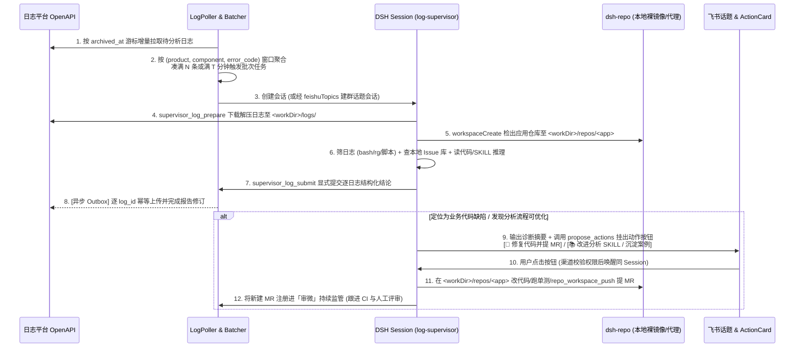

# 02. 日志自动监管闭环设计（观象域）

本文档定义 `dsh-supervisor` 中 **日志异常自动监管闭环（观象）** 的完整数据流、调度规则、Agent 工具链与后续修复/改进门控机制。

---

## 一、端到端工作流概览

日志监管支持 **「日志平台自动轮询」** 与 **「飞书人工会话（发日志 ZIP / `/logalyze`）」** 两条入口，但进入诊断阶段后**完全共享同一套工作区布局、同一套 `log-supervisor` 能力工具与后续动作提议机制**：



---

## 二、日志平台感知与批次调度（`LogPoller` & `BatchScheduler`）

### 1. 接入与匹配规则
- **唯一仓库源**：`dsh-supervisor` 在启动时调用 `dshRepos.featureRegister({ id: 'log-analysis', title: '日志分析', description: '...' })`。凡在 `dsh-repo` 仓库清单中启用「日志分析」的仓库自动成为候选应用。
- **名称与别名匹配**：在监管面板中为每个应用配置业务描述与触发别名（同时匹配平台原始 `component_code` 与飞书自然语言提及的应用名；采用 Unicode NFKC 规范化 + 忽略大小写）。无匹配或存在多仓库别名歧义时记录诊断告警，绝不盲猜仓库。
- **可选知识（Optional SKILL）**：不要求仓库必须包含 `.agents/logalyze.yaml` 或特定 SKILL。检出代码后自动扫描 `<workDir>/repos/<app>/.dsh/skills` 与 `.agents/skills`；存在适用 SKILL 时由 Agent 按需加载并可执行其附带脚本，无 SKILL 时直接结合日志与源码分析。

### 2. 轮询、分批与防风暴策略

| 策略项 | 默认配置（支持面板热改） | 精确语义 |
| :--- | :--- | :--- |
| **资格过滤** | 已归档可下载的 FDS 日志 | `component_code` 能唯一映射到已启用仓库；排除已有有效结论、正在运行中、或已标记最终失败待人工处理的 `log_id` |
| **水位线起点** | 首次启用时刻（`archived_at`） | 持久化于 `watermarks` 表，支持面板手动回拨补跑历史；采用 `(archived_at, log_id)` 复合游标分页，防止同秒归档漏单 |
| **轮询周期** | `60s` | 上一轮拉取未结束时不重叠发起；平台 429/5xx 指数退避并在面板状态头告警 |
| **分组键** | `(product_code, component_code, error_code)` | 缺省 `error_code` 归入 `'<none>'` 独立成组；分组只用于合并批次输入，**严禁 Agent 未经逐份核对直接把单份日志结论复制给全组** |
| **攒批窗口** | 满 `5` 份 **或** 首条等待满 `5 分钟` | 单批上限 `20` 份；首条进入窗口即持久化 `windowOpenedAt`，后续新日志进入不重置倒计时，重启不丢等待状态 |
| **并发与熔断** | 全局并发上限 `4` 批；单应用每小时上限 `15` 批 | 独立于 MR 评审并发池；某应用线上雪崩狂刷日志触发每小时上限时，该应用自动进入 `throttled` 熔断态并向飞书发一条汇总告警卡，其余应用不受影响 |

### 3. 飞书投递模式（可按应用或全局配置）
- **模式 A：`topic-on-start`（开局建话题流式可见）**：批次发车时即调用 `feishuTopics.launch` 在目标群发根卡（列出批次内各 `log_id` 链接）并建立话题，全过程流式可见。
- **模式 B：`quiet-until-done`（静默分析、产出即建话题，推荐高频场景）**：批次先在本地后台 Session 完成分析与平台报告回传；结束后调用 `feishuTopics`（或群结论卡）一次性发出结构化结论与后续动作按钮，并将话题绑定至该原 Session 供人工追问，群内零过程刷屏。

---

## 三、会话内目录布局与安全模型

每个分析任务运行在自己的专属会话目录 `<workDir>` 下：

```text
<workDir>/
├── logs/
│   ├── manifest.json            # 批次输入清单（各槽位 L1..Ln 元数据、平台 log_id、原始包路径）
│   ├── L1/                      # 安全解压后的第 1 份日志目录（防路径穿越、防符号链接逃逸、限解压总字节）
│   └── L2/
├── repos/
│   └── <app-slug>/              # dshRepos.workspaceCreate 创建的共享对象 Git 克隆（检出日志分析功能分支最新提交）
└── scratch/                     # Agent 编写临时解析脚本、聚合时间线 CSV 或报告附件的工作目录
```

**为什么这套布局彻底消除了旧方案的安全与能力冲突？**
1. `<workDir>` 是该会话的 `cwd`：宿主 `ctx.sandbox` 在 `workspace-write` 模式下只允许写入 `<workDir>` 内部，宿主凭据库与系统目录受保护。
2. `dsh_channels` 的 `ReadFence` 天然放行 `<workDir>` 下的一切子路径（包括 `logs/` 与 `repos/<app-slug>/`），无需跨插件动态授权或禁用 `bash`。
3. `repos/<app-slug>` 的 `origin` 指向 `dsh-repo` 本机 `127.0.0.1` 代理，磁盘内不含任何 GitHub/GitLab Token；在未获得 `code-write` 授权前，任何 `git push` 均被代理层硬拦截，但本地 `git log -S`、`git blame`、`git show` 100% 可用。

---

## 四、模型工具链设计（薄工具 + 强校验）

摒弃复杂的隐式钩子，为 `log-supervisor` 提供 4 个职责单一的原子工具：

### 1. `supervisor_log_prepare`
- **作用**：幂等准备当前会话的分析材料。
  - 若为平台自动任务：根据预登记的 `taskId` 下载各 `log_id` 归档包并解压至 `logs/L1..Ln`，调用 `dshRepos.workspaceCreate` 准备 `repos/<app-slug>`，扫描仓库可用 SKILL 列表，并自动检索本地 `IssueMemory` 中同应用的候选已知问题（含人工纠偏记录）一并返回。
  - 若为飞书人工发起任务：接收应用名称/别名与当前话题附件路径（或允许白名单域名的下载 URL），执行同样的解压、代码检出与已知问题预检索。
- **追问行为**：同 Session 后续追问时，`logs/` 与 `repos/<app-slug>` 原路径持续有效，无需重复解压或更换路径。

### 2. `supervisor_issue_search`
- **作用**：在分析中途提取出新的异常特征（如特定异常类名、模块名、错误码）后，随时向本地 `IssueMemory` 进行全文/条件检索，核对历史同类问题的识别条件、排除条件与**人工确认结论**。

### 3. `supervisor_log_submit`
- **作用**：显式提交或修订结构化分析结论（唯一正式结果入口，绝不从自由聊天文本猜测结论）。
- **核心入参结构**：
  ```ts
  export interface LogSubmitInput {
    /** 本次批次总体摘要（面向飞书卡片与多维表格摘要） */
    readonly summary: string
    /** 逐份日志结论（必须覆盖 manifest 中的每一个 L1..Ln，不漏项、不重项） */
    readonly items: readonly {
      readonly ref: string // 'L1', 'L2', ...
      readonly status: 'diagnosed' | 'insufficient_evidence' | 'corrupted_log'
      readonly rootCauseCategory: 'code_defect' | 'config_or_env' | 'hardware_or_external' | 'usage_error' | 'unknown'
      readonly conclusion: string
      /** 可追溯的关键证据引用（日志文件相对路径 + 行号/时间戳 + 关键摘录；若是代码缺陷须附代码文件路径与行号 + commit SHA） */
      readonly evidences: readonly { readonly source: string; readonly locator: string; readonly excerpt: string }[]
      /** 关联已有已知问题 issueId，或提议归档为新问题草稿 */
      readonly issueLink?:
        | { readonly mode: 'existing'; readonly issueId: string }
        | {
            readonly mode: 'new'
            readonly title: string
            readonly matchCriteria: string
            readonly exclusionCriteria?: string
            readonly resolutionAdvice: string
          }
    }[]
    /** 可选：附带上传至日志平台的额外 Markdown 图表或时间线文件（位于 scratch/ 下） */
    readonly attachments?: readonly string[]
  }
  ```
- **确定性校验与副作用**：
  1. 校验所有 `ref` 与任务输入 1:1 对齐，校验引用的代码文件或日志路径真实存在。
  2. 原子写入 `log_tasks` 新修订（生成单调递增 `revision`），同步更新本地 `IssueMemory`（复用的更新 `lastSeenAt` 与最近报告；新建的分配稳定 `issueId` 并入队多维表格异步同步；**绝不覆盖人工结论列**）。
  3. 为每个具有平台 `log_id` 的条目向 `outbox_platform` 写入幂等回传任务（复用成熟的报告创建、预签名直传与完成发布逻辑，支持断网/重启自动补传，旧修订绝不覆盖新修订；飞书人工无 `log_id` 的本地 ZIP 自动跳过平台回传）。
  4. 若关联了飞书话题根卡，自动调用 `feishuTopics.updateLinks` 回填报告详情链接。

---

## 五、主动门控闭环：修代码 & 改进 SKILL

当 `supervisor_log_submit` 成功落盘后，`log-supervisor` Preset 的系统提示词指导模型根据本次排查事实，按需调用 `propose_actions` 主动询问用户：

### 场景 1：定位为明确代码缺陷 → 主动询问是否进行代码修复
- **触发条件**：至少一份日志 `rootCauseCategory === 'code_defect'`，且已在 `repos/<app-slug>` 中定位到具体缺陷文件与根因机制，并且该仓库在 `dsh-repo` 清单中的权限为 `write` 或 `merge`。
- **提议动作配置**：
  - `id`: `'fix_code'`
  - `label`: `'🔧 修复代码并提 MR'`（`style: 'primary'`，`requiredAccess: 'code-write'`，`independent: true`）
  - `followUpPrompt`: 内含目标仓库目录 `repos/<app-slug>`、基准提交、根因文件行号、修复思路及验证要求。
- **用户点击后的闭环执行**：
  1. 原 Session 被唤醒（拥有完整的前序日志证据与代码阅读上下文！）。
  2. 在 `repos/<app-slug>` 中基于功能分支或基线分支切出修复分支，修改业务代码并补充回归单元测试。
  3. 使用 `bash` 在本地工作区运行项目测试/类型检查通过后，调用 `repo_workspace_push`（附带 `mr: { title, body }`，正文中自动附带本次异常日志现象、根因证据与测试结果）。
  4. 新建的修复 MR 自动写入本地 `IssueMemory` 的关联修复链接，并**自动注册进「审微」MR 监管表（标记 `origin: 'self-fix'`）**——若后续 CI 失败或人工 Reviewer 提出修改意见，自动唤醒本 Session 继续修复推送！

### 场景 2：分析流程可优化或发现新案例 → 主动询问是否触发知识改进
- **触发条件**（满足任一即可，不仅限于代码缺陷）：
  - 仓库尚无日志分析 SKILL，但本次摸清了该应用的日志目录结构、关键状态机关键字或解析脚本；
  - 现有 SKILL 存在过时字段、误导说明，或本次编写的 `scratch/*.py` 解析脚本值得固化进 SKILL `scripts/`；
  - 本次定位出了具有复用价值的典型新故障案例，值得写入仓库案例库（按稳定 `issueId` 创建或更新案例文档，避免每次按日期堆砌重复文件）。
- **提议动作配置**：
  - `id`: `'improve_skill'`
  - `label`: `'📚 改进分析流程 / 沉淀案例'`（`style: 'default'`，`requiredAccess: 'code-write'`，`independent: true`）
- **用户点击后的闭环执行**：
  - 注意 `independent: true` 允许用户**既点「修复代码并提 MR」，又点「改进分析流程 / 沉淀案例」**！为避免业务代码修复分支与文档/SKILL 改进混在同一个 MR 中拖慢合入，知识改进动作在 `<workDir>/repos/<app-slug>-knowledge` 单独创建干净的 `workspaceCreate` 工作区，修改 `.agents/skills/` 或案例目录并提交独立的 `docs/chore` MR，由人工评审合入后自动惠及后续所有分析。
