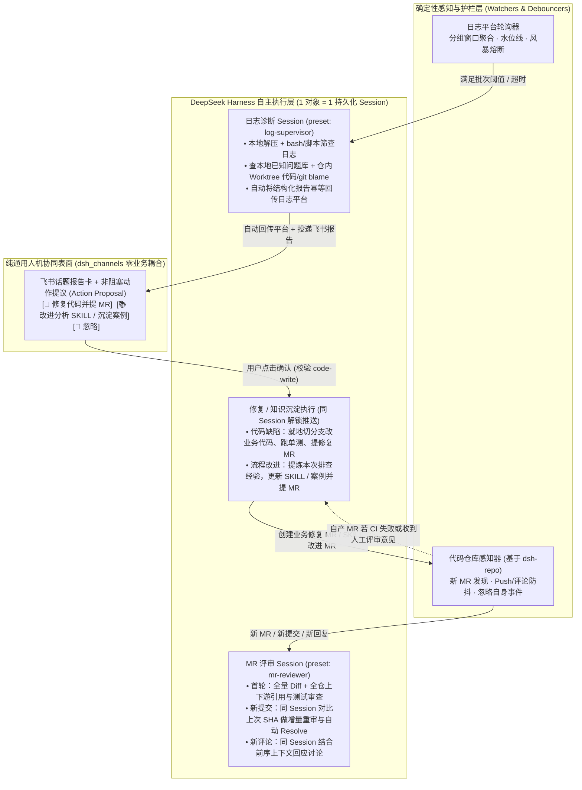
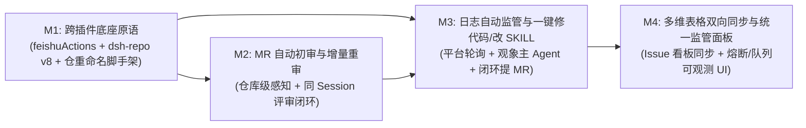

# dsh-supervisor 架构设计与开发路线图

> **定位**：基于 [DeepSeek Harness (`dsh`)](../../../deepseek-harness) 构建的 **AI-Native 研发自主监管中心**（由原 `dsh-logalyze` 合并演进）。
> **核心目标**：将研发链路中原本依赖人工盯盘与手动触发的动作，全面升级为由持久化 Agent Session 持续监管、自主研判，并在关键写操作节点主动向人类发起决策门控的闭环系统。

---

## 一、文档导航

| 文档 | 内容范围 |
| :--- | :--- |
| **[README.md](./README.md)**（本文） | 顶层愿景、五大架构准则、三仓职责边界、端到端业务闭环与分阶段里程碑（Roadmap） |
| **[01-cross-plugin-contracts.md](./01-cross-plugin-contracts.md)** | 跨插件契约规范：`dsh_channels` 通用非阻塞动作提议卡（`feishuActions`）与 `dsh-repo` v8 行级评审/增量感知接口 |
| **[02-log-supervision.md](./02-log-supervision.md)** | **日志监管域（观象）**：日志平台轮询聚合、主 Agent 诊断、结论自动回传、已知问题库，以及主动提议「修代码 / 改 SKILL」闭环 |
| **[03-mr-supervision.md](./03-mr-supervision.md)** | **代码评审域（审微）**：仓库级新 MR 自动发现、同 Session 有状态初审、新 Push 增量 Diff 重审、新评论互动与自产 MR 修复闭环 |
| **[04-storage-and-operations.md](./04-storage-and-operations.md)** | 持久化存储表结构、沙箱与防风暴熔断护栏、Web「智能监管」面板设计、以及从 `dsh-logalyze` 演进为 `dsh-supervisor` 的代码重构清单 |

---

## 二、业务闭环全景

`dsh-supervisor` 在同一套监管运行时上打通两大核心闭环，并通过「提交 MR」将二者自然衔接成一个自演进飞轮：

---

## 三、五大核心架构准则（重构基石）

针对旧版 `defect-loop` 方案“跨仓特判耦合重、阉割 Agent 工具、短命快照断上下文、外部多维表格阻塞主链路”的痛点，新架构确立五条硬准则：

### 1. 控制面与认知面彻底分层
- **确定性控制面（TypeScript 守护服务）** 只做四件事：外部轮询感知（Sensor）、窗口防抖与去重（Batch/Debounce）、并发预算与风暴熔断（Circuit Breaker）、外部副作用幂等投递队列（Outbox）。
- **自主认知面（Agent Preset + SKILL + 原子 Tools）** 接管全部诊断与评审过程：如何用脚本筛日志、何时查已知问题、何时派发子代理（Subagent）、如何顺着调用链审代码、如何组织修复补丁——**绝不在插件代码里手写死板的业务步骤状态机**。

### 2. 以 DSH Session 为唯一状态中心，飞书彻底退回纯渠道表面
- **`dsh_channels` 零业务感知**：不包含任何日志分析或代码评审专有逻辑，不硬编码业务工具白名单。
- 外部监管任务统一通过 `feishuTopics`（建话题与根卡）+ 新增的**通用非阻塞动作提议服务（`feishuActions` / `propose_actions`）**与人类协作：回合正常结束不挂起；飞书卡片底部展示持久化动作按钮；用户随时点击按钮即经渠道判权后唤醒原 Session 执行后续动作。

### 3. 会话内共享镜像克隆（In-Workspace Mirror Clone），打通「只读排查 → 就地修代码」
- 抛弃旧方案的外部目录短命 `SnapshotLease` 与手写工具路径拦截。
- 所有分析或评审任务均通过 `dshRepos.workspaceCreate`（`access: 'read'`，底层从本地裸镜像共享 Git 对象，秒级创建、几乎零额外磁盘开销）将代码检出在**当前会话工作目录内部** `<sessionWorkDir>/repos/<slug>`：
  1. **天然合规**：路径本身位于话题工作区内，无需任何特判即可通过 `dsh_channels` 既有 `ReadFence` 与宿主 `workspace-write` 进程沙箱（`ctx.sandbox`）。
  2. **全能力释放**：Agent 可正常使用 `bash`、Python/jq/rg、仓库自带 SKILL 脚本，以及 `git log -S`、`git blame`、`git diff`；多轮追问路径永久有效。
  3. **零摩擦转写**：远端推送由 `dsh-repo` 本机 Git 代理拦截（无令牌泄露风险，强制校验仓库写权限与飞书 `code-write` 开关）。当用户点击 `[🔧 修复代码并提 MR]` 时，Agent 直接在同一工作区编辑代码、跑测试、调用 `repo_workspace_push` 提 MR，上下文 100% 连续。

### 4. 「1 个监管实体 = 1 个有记忆的持久化 Session」
- **1 批同组异常日志 = 1 个分析 Session**：支持人工在飞书话题内连续追问纠偏、二次更新平台回传报告、接着修代码或沉淀 SKILL。
- **1 个 PR/MR = 1 个评审 Session**：持久化记录 `lastReviewedSha` 与 `lastDiscussionCursor`。新 Push 或新评论到来时唤醒**同一个 Session**，只喂入增量 `git diff <oldSha>..<newSha>` 与新评论线程；依靠会话历史（超长时由 DSH 原生 `compaction` 压缩）实现“记得上轮提过什么、修好的自动 Resolve、合理的解释不再复读刷屏”。

### 5. 本地 `storageDomain` 为唯一主存，外部系统全部走异步幂等同步
- 已知问题库（Issue Memory）、轮询水位线、平台报告回传状态均存放在宿主 `ctx.storageDomain('dsh_supervisor')`（毫秒级读写、100% 可用）。
- 日志平台报告上传、飞书多维表格读写全部作为**后台幂等同步器（Outbox / Sync Worker）**运行：外部 API 抖动或未配置多维表格时，绝不阻塞主分析流程，恢复后自动补齐。

---

## 四、仓库职责重划矩阵

整个体系由 3 个扩展仓库协同构成，依赖方向严格单向（`dsh-supervisor` 按需发现并调用 `dsh-repo` 与 `dsh_channels` 的公开契约，后两者互不依赖、也不反向感知业务）：

| 仓库 | 演进策略 | 核心职责边界 |
| :--- | :--- | :--- |
| **`dsh_channels`** | **保持纯渠道 + 新增 1 个通用原语** | 保持现有飞书长连接、路由、附件 v2、`feishuTopics` v3、`ReadFence` 与 `access/authorize` 不变；**仅新增通用的非阻塞动作提议卡（`feishuActions` v1）**，支持任意会话在回合末挂出持久化操作按钮并在点击后回调唤醒该会话。 |
| **`dsh-repo`** | **契约升级至 v8（补齐行级评审能力）** | 保持现有主机管理、仓库清单、裸镜像、本地工作区与 Git 代理不变；**补齐 GitHub / GitLab 双端 PR/MR 行级评审（Inline Review Comments）与讨论线程读取/回复/Resolve API**，并为 `mrList` 补充按更新时间排序筛选以支撑高效仓库级增量扫描。 |
| **`dsh-supervisor`** *(原 `dsh-logalyze` 演进)* | **合并演进为统一监管中心** | 向 `dsh-repo` 注册「日志分析」与「MR 自动评审」两项仓库级功能开关；内含共享监管底座（调度/防抖/熔断/Outbox）、**日志监管域（观象）**、**MR 监管域（审微）**、闭环修复与 SKILL 沉淀动作编排，以及统一的 Web 侧栏「智能监管」管理面板。 |

---

## 五、分阶段开发路线图（Roadmap）

按**先立通用原语、先跑通高频短链路（MR 自动评审）、再合拢日志分析与自动修代码大闭环**的节奏分为 4 个里程碑，每个里程碑均可独立构建、测试与上线验收：

### Milestone 1：跨插件底座原语与 `dsh-supervisor` 骨架
- **涉及仓库**：`dsh_channels`、`dsh-repo`、`dsh-supervisor`
- **交付内容**：
  1. `dsh_channels` 实现 `feishuActions` v1 服务与 `propose_actions` 面向模型工具，支持持久化按钮渲染、权限校验（`chat` / `code-write` / `admin`）、重启恢复与唤醒投递。
  2. `dsh-repo` 升级至契约 v8：实现 GitHub（Octokit + GraphQL thread resolve）与 GitLab（GitBeaker Discussions）的 `mrDiscussions`、`mrReview`、`mrDiscussionReply`、`mrDiscussionResolve` 及 `mrList` 更新时间增量筛选。
  3. 将 `dsh-logalyze` 包结构重构升级为 `dsh-supervisor`（保留兼容配置读取提示），搭建共享监管运行时（`storageDomain` 表封装、任务并发池、熔断器、幂等 Outbox）。
- **验收标准（AC-M1）**：
  - 任意测试 Session 调用 `propose_actions` 可在飞书生成按钮，重启 DSH 后点击按钮仍能校验权限并唤醒原 Session，重复点击幂等拦截。
  - `dsh-repo` 单测与契约验证覆盖 GitHub / GitLab 行级评论创建、回复与 Resolve。

### Milestone 2：代码仓库 MR 自动初审与增量重审闭环（审微）
- **涉及仓库**：`dsh-supervisor`（依赖 M1 的 `dsh-repo` v8）
- **交付内容**：
  1. 向 `dsh-repo` 注册 `mr-review`（「MR 自动评审」）仓库功能开关；实现 `RepoMrWatcher`（增量扫描新开 MR、Push 与新讨论，90s 防抖窗口，严格过滤机器人自身账号动作）。
  2. 实现 `mr-reviewer` Agent Preset、内置评审 SKILL 与状态推进工具 `supervisor_mr_checkpoint`：在 `<workDir>/repos/<slug>` 中结合全仓代码与调用链做首次行级评审；新提交与新评论唤醒**原 Session**做增量 Diff 重审、自动 Resolve 已修问题、回复作者讨论。
  3. 支持可选配置将 MR 评审摘要卡投递至指定飞书群（通过 `feishuTopics`），并在 MR 合并/关闭时同步更新状态。
- **验收标准（AC-M2）**：
  - 在已开启「MR 自动评审」的仓库新建 MR，自动触发初审并落行级评论；连续推送 2 个修复提交后防抖合并触发一次同 Session 重审，已修复项被自动 Resolve、未修项继续跟进，机器人自身评论绝不触发自激循环。

### Milestone 3：日志平台自动监管 + 主动询问「修代码 / 改 SKILL」大闭环（观象）
- **涉及仓库**：`dsh-supervisor`
- **交付内容**：
  1. 日志平台轮询器（`LogPoller`）与批次聚合调度器（按 `product + component + error_code` 凑满 N 条或超时 T 分钟发车，持久化水位线与单应用熔断）。
  2. 统一「平台自动批次」与「飞书手动发日志 ZIP / `/logalyze`」到同一套 `log-supervisor` Agent Preset：在 `<workDir>` 解压日志、挂载 `<workDir>/repos/<app>` 镜像工作区与仓库可选 SKILL、开放受沙箱保护的 `bash` 分析能力、检索本地已知问题库 `IssueMemory`。
  3. 结构化结果提交工具 `supervisor_log_submit`：落盘结果修订，异步通过 Outbox 逐 `log_id` 回传日志平台报告，并向飞书投递/更新报告卡。
  4. **主动动作门控闭环**：
     - 根因定位到业务代码缺陷时，自动通过 `propose_actions` 挂出 `[🔧 修复代码并提 MR]`；点击后就地修改业务代码、执行测试、调用 `repo_workspace_push` 创建修复 MR，并自动纳入 M2 的 MR 持续监管（CI 挂了或人工提意见自动唤醒续修）。
     - 排查发现新故障模式或现有分析 SKILL 不足时，挂出 `[📚 改进 SKILL / 沉淀案例]`；点击后提炼当前 Session 排查链路并提交知识改进 MR。
- **验收标准（AC-M3）**：
  - 平台新归档日志在无人干预下完成拉取、分析、平台报告回传与飞书通知；飞书无平台配置时手动上传 ZIP 同样走通分析与追问。
  - 点击 `[🔧 修复代码并提 MR]` 与 `[📚 改进 SKILL / 沉淀案例]` 均能在同一会话上下文中产出真实可评审的 PR/MR，且后续在该 MR 下的评论能继续唤醒跟进。

### Milestone 4：飞书多维表格双向同步与 Web 统一监管面板
- **涉及仓库**：`dsh-supervisor`、`dsh_channels`（若需窄化服务端表格读写 helper）
- **交付内容**：
  1. 本地 `IssueMemory` 与飞书多维表格后台双向同步器：自动归档/更新同类问题行（稳定 `issueId`），读取人工填写的「人工确认/纠正」注入下次同类分析上下文，绝不覆盖人工列。
  2. Web 左侧栏「智能监管」整页面板：统一管理运行总览与熔断状态、应用描述与触发别名、日志平台参数、MR 评审策略，以及问题库同步状态。
- **验收标准（AC-M4）**：
  - 同应用同类根因复用同一 `issueId` 不膨胀多维表格；多维表格断网或无权限时主分析零受阻，恢复后自动补同步；人工在多维表格写下纠偏结论后，下一次同类日志分析明确引用并核验该人工结论。
